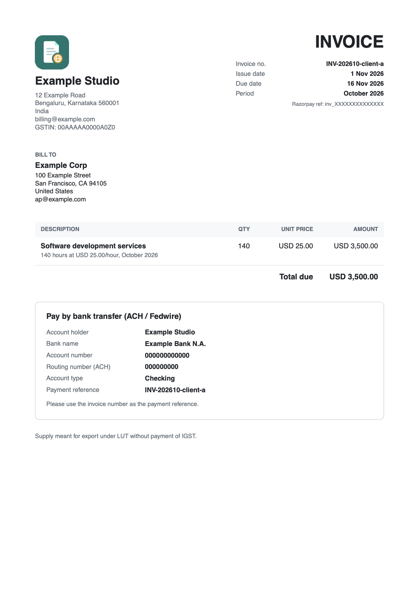

<p align="center">
  
</p>

<h1 align="center">Razorpay International Auto-Invoicer</h1>

<p align="center">Monthly invoices for overseas clients who pay into a Razorpay MoneySaver Export Account.</p>

<p align="center">
  <a href="https://github.com/ananthpranav/razorpay-intl-auto-invoicer/actions/workflows/ci.yml"></a>
  <a href="https://github.com/ananthpranav/razorpay-intl-auto-invoicer/releases"></a>
  <a href="https://github.com/ananthpranav/razorpay-intl-auto-invoicer/pkgs/container/razorpay-intl-auto-invoicer"></a>
  
  <a href="LICENSE"></a>
</p>

I bill a few clients abroad every month. They pay by bank transfer into my Razorpay MoneySaver Export Account (MSEA), and every month it was the same routine: create the invoices in Razorpay, make PDFs with the right bank details, email them, and later dig out the matching PDF when a transfer arrived so Razorpay would settle it. This tool does that for me. It runs in Docker on my own server.

## What it does

- On the 1st it creates a Razorpay invoice for each client, in their currency, and emails them a PDF with your bank details for that currency.
- Every day it checks for new transfers, works out which invoice each one pays, and emails you that PDF to upload in Razorpay.
- If you want, it also emails clients a receipt when their money arrives and a reminder when an invoice is overdue.
- On the 3rd it emails you last month's settlements as a CSV, for your books.
- Running a job twice is safe. It never creates the same invoice twice or emails anyone twice.

<p align="center"></p>

## Quick start

You need Docker, your Razorpay API keys, a customer in Razorpay for each client, and an email account that can send over SMTP (a Gmail or Zoho app password works).

```sh
mkdir invoicer && cd invoicer
docker run --rm -u "$(id -u):$(id -g)" -v "$PWD:/config" \
  ghcr.io/ananthpranav/razorpay-intl-auto-invoicer init /config
```

That writes four files for you to edit: `.env`, `clients.json`, `bank-details.json` and `docker-compose.yml`. Fill them in (see below), then check everything before going live:

```sh
docker compose run --rm invoicer probe               # what Razorpay returns for your account
docker compose run --rm invoicer invoice --dry-run   # a preview: nothing is created or sent
docker compose up -d                                 # start the schedule
```

Use `rzp_test_` keys until the dry run looks right. `docker compose pull` gets new versions; pin a tag like `:1` in `docker-compose.yml` if you'd rather update by hand.

## Setting it up

### clients.json

One entry per invoice. Two clients billed hourly and one on a fixed fee look like this:

```json
[
  { "label": "client-a", "customerId": "cust_XXXXXXXXXXXXXX", "currency": "USD",
    "items": [{ "type": "hourly", "name": "Software development services", "rate": 25, "hours": 140 }] },
  { "label": "client-b", "customerId": "cust_YYYYYYYYYYYYYY", "currency": "USD",
    "items": [{ "type": "hourly", "name": "Software development services", "rate": 25, "hours": 20 }] },
  { "label": "client-c", "customerId": "cust_ZZZZZZZZZZZZZZ", "currency": "GBP",
    "items": [{ "type": "fixed", "name": "Monthly retainer", "amount": 250 }] }
]
```

That bills USD 3,500, USD 500 and GBP 250. `customerId` is the Razorpay customer ID; `docker compose run --rm invoicer customers` lists yours. The `label` goes into the invoice number (`INV-202610-client-a`).

Other fields you can add to an entry:

| Field | What it's for |
| --- | --- |
| `billTo` | The client's address on the PDF: `name`, `line1`, `line2`, `city`, `state`, `postalCode`, `country`. MSEA wants the buyer's address, so add it unless the Razorpay customer already has one. |
| `emailTo`, `emailCc` | Who gets the invoice. By default it goes to the customer's email in Razorpay. |
| `dueInDays` | Days until the invoice is due, if different from `DUE_IN_DAYS`. |
| `enabled` | `false` stops invoicing that client. |
| `description` on an item | Your own line text. `{period}`, `{hours}` and `{rate}` are filled in. |

Amounts are in normal units (`25` is USD 25.00). Fractional hours are fine. To bill one client twice a month, add two entries with the same `customerId` and different labels.

### bank-details.json

The account details from your MSEA dashboard, one block per currency. They're printed on the PDF and in the email exactly as you write them. Razorpay has no API for these, so you copy them in once.

```json
{
  "USD": {
    "title": "Pay by bank transfer (ACH / Fedwire)",
    "fields": [
      { "label": "Account holder", "value": "Your Business Name" },
      { "label": "Account number", "value": "…" },
      { "label": "Routing number (ACH)", "value": "…" }
    ],
    "note": "Please use the invoice number as the payment reference."
  }
}
```

### .env

Every setting is explained in the file itself. The ones you'll touch:

- `RAZORPAY_KEY_ID` and `RAZORPAY_KEY_SECRET`.
- The `SMTP_*` settings, `EMAIL_FROM`, and `OWNER_EMAIL` (that's you: summaries, payment updates and alerts go there).
- `INVOICE_FOOTER`, for your LUT line or anything else under the invoice.
- `INVOICE_TIMEZONE` and the three schedules, if 09:00 India time on the 1st doesn't suit you.

Your business name and logo come from Razorpay (whatever Razorpay Checkout shows). Your address and GSTIN come from Razorpay too if its Accounts API lets you read them; set `RAZORPAY_ACCOUNT_ID` and run `probe` to find out. Anything you set in `BUSINESS_*` wins. To use your own logo, mount it and point `BUSINESS_LOGO_PATH` at it.

## When a client pays

The daily check spots the transfer and emails you which invoice it belongs to, with the PDF attached. Razorpay only settles it after you attach that invoice:

1. In the Razorpay Dashboard, open **Transactions** and filter by **Pending Actions**.
2. Click **+ Add Details** on the transfer.
3. Upload the PDF from the email and paste in the buyer's address from the same email.

The check finds the invoice by the invoice number in the transfer reference, or by the amount when it's the only open invoice with that amount. Anything unclear comes to you instead. If it got one wrong, or missed one, fix it with:

```sh
docker compose run --rm invoicer payments --match pay_XXXXXXXXXXXXXX=INV-202610-client-a
```

Receipts and reminders to clients are off by default (`SEND_PAYMENT_RECEIPTS`, `SEND_REMINDERS`). Razorpay doesn't document how MSEA transfers show up in its API, so turn them on only after `payments --dry-run` has matched a real transfer correctly. The first check only records what's already there, and a receipt or reminder that didn't go out on time is never sent late.

## Commands

Run them with `docker compose run --rm invoicer <command>`, or `npm run <command>` without Docker.

| Command | What it does |
| --- | --- |
| `start` | Runs the jobs on their schedules. This is what `docker compose up` runs. |
| `invoice` | Creates this month's invoices now. `--dry-run`, `--send-preview`, `--period 2026-09`, `--only client-a`, `--resend`, `--reissue` |
| `payments` | Checks payments now and retries failed emails. `--dry-run`, `--match <payment>=<invoice>` |
| `report` | Emails last month's settlement report. `--month 2026-09` |
| `customers` | Lists your Razorpay customers. `--create --name "Client" --email …` adds one. |
| `probe` | Shows what Razorpay returns for your account. Read-only. |
| `init [dir]` | Writes the config files, without touching files that exist. |

If something goes wrong: a failed client email is retried on the next run and every day after. If you cancel an invoice in Razorpay, `invoice --reissue --only <label>` makes a new one. A missed month is `invoice --period 2026-09`.

## Without Docker

You need Node 22.18 or newer.

```sh
git clone https://github.com/ananthpranav/razorpay-intl-auto-invoicer.git
cd razorpay-intl-auto-invoicer
npm ci
npm run init      # writes .env, clients.json, bank-details.json
npm run probe
npm start         # or run the single commands from cron
```

Node runs the TypeScript directly, so there's no build step. Keep it running with pm2 or a systemd service.

## Things to know

- Razorpay keeps these invoices as "issued", because the money doesn't come through the invoice link. The tool keeps track of what's paid on its own.
- Razorpay's API can't make GST invoices or add tax to foreign-currency invoices. Put your export or LUT wording in `INVOICE_FOOTER`.
- Only currencies with two decimals are supported (USD, GBP, EUR, AUD, CAD and so on).
- FIRS certificates and the MSEA upload itself are manual. Razorpay has no API for either.
- `.env`, `clients.json`, `bank-details.json`, the PDFs and the state file stay on your machine. They're in `.gitignore`, and the logs never print keys, names, addresses, bank details or amounts.

## Contributing

Bug reports and pull requests are welcome. See [CONTRIBUTING.md](CONTRIBUTING.md) to get started, and please follow the [code of conduct](CODE_OF_CONDUCT.md). Report security problems privately, as described in [SECURITY.md](SECURITY.md). Changes are listed on the [releases page](https://github.com/ananthpranav/razorpay-intl-auto-invoicer/releases).

## License

[MIT](LICENSE). Not affiliated with Razorpay.
